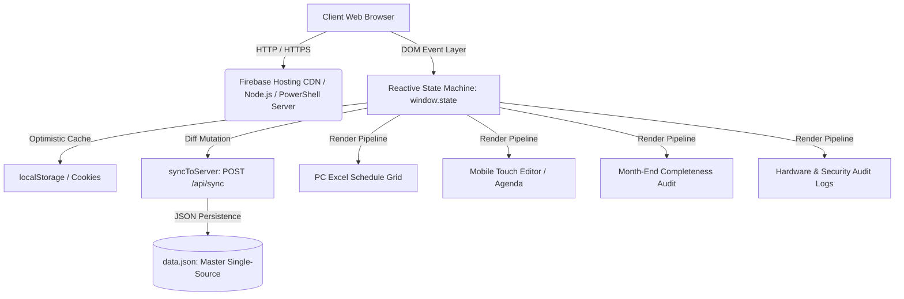
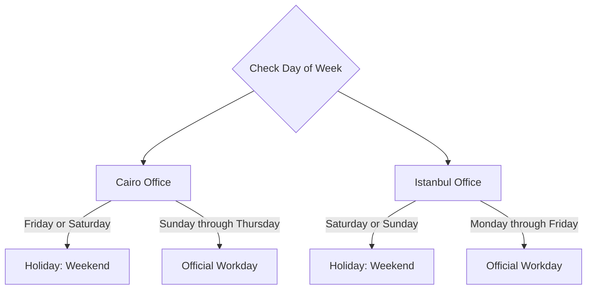
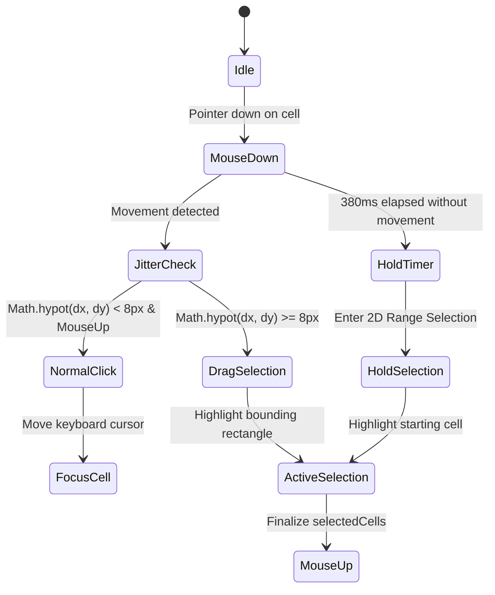
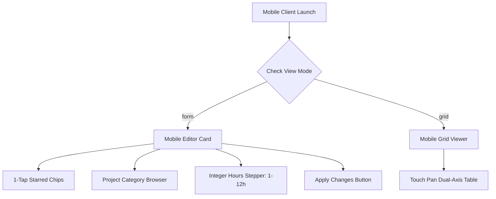

# ALSTOM IXL Team Hours Tracker & Resource Allocation System
## Deep Technical Architecture, System Internals, & Developer Reference Manual

> **Document Version**: 2.0.0  
> **Target Audience**: Software Engineers, System Architects, & AI Autonomous Agents  
> **Classification**: Strictly Technical / Engineering Specification  
> **Live Production System**: [https://ixl-hours-tracker.web.app](https://ixl-hours-tracker.web.app)  
> **Source Repository**: `https://github.com/PeterMG97/ixl-hours-tracker.git` (branch: `main`)  
> **Maintenance Contract**: Any addition, modification, or removal of functionality across this codebase MUST be accompanied by an immediate update to this document.

---

## Table of Contents
1. [Executive System Overview](#1-executive-system-overview)
2. [End-to-End Technology Stack](#2-end-to-end-technology-stack)
3. [Repository Directory & Complete File Map](#3-repository-directory--complete-file-map)
4. [Master Data Models & State Architecture](#4-master-data-models--state-architecture)
5. [Temporal Logic & Dual-Office Weekend Rules](#5-temporal-logic--dual-office-weekend-rules)
6. [Desktop (PC) Interface Deep Architecture](#6-desktop-pc-interface-deep-architecture)
7. [Mobile Interface Deep Architecture & Touch Physics](#7-mobile-interface-deep-architecture--touch-physics)
8. [Role-Based Access Control, Security, & View-Only Defense](#8-role-based-access-control-security--view-only-defense)
9. [Audit Logging, Device Fingerprinting, & Security Directory](#9-audit-logging-device-fingerprinting--security-directory)
10. [Client-Server Synchronization & Storage Layer](#10-client-server-synchronization--storage-layer)
11. [Styling Engine, Theme System, & Responsive Design](#11-styling-engine-theme-system--responsive-design)
12. [Comprehensive Automated Test Suites Catalog](#12-comprehensive-automated-test-suites-catalog)
13. [Deployment Pipeline & Production Releases](#13-deployment-pipeline--production-releases)
14. [Developer Maintenance Contract & Engineering Guidelines](#14-developer-maintenance-contract--engineering-guidelines)

---

## 1. Executive System Overview

The **Alstom IXL Team Hours Tracker** is an enterprise-grade Single Page Application (SPA) designed for multi-regional engineering resource management across Alstom's **Cairo** and **Istanbul** engineering offices.

The system serves dual primary objectives:
1. **Accurate Hourly Work Allocation**: Enabling engineering personnel to log daily hours against specific active railway signaling projects, tenders, technical training, and inter-team support tasks, while handling local holiday calendars and default daily schedules.
2. **Double-Entry Accounting & Audit Control**: Providing team leads, project managers, and administrators with completeness auditing, project baseline tracking, security logging, and tamper-resistant audit trails.



### Key Architectural Tenets
- **Zero Heavy Framework Runtime**: Implemented in clean, modern vanilla JavaScript (ES6+), semantic HTML5, and CSS3. Zero client-side dependencies (no React, Angular, Vue, or Webpack bundles required), enabling sub-100ms cold starts, instantaneous DOM mutations, and zero build compilation lag.
- **Strict Deterministic Math**: Full double-entry reconciliation between project hours and employee hours. Project Sum strictly equals Employee Sum at all times.
- **Universal Zero-Emoji Protocol**: Strict corporate policy prohibiting Unicode emojis across UI text, source code, data payloads, test suites, and commit logs.

---

## 2. End-to-End Technology Stack

| Layer | Technology | Specification / Runtime |
|---|---|---|
| **Client Frontend** | Vanilla JavaScript (ES6+) | No framework, DOM-direct mutations, event delegation |
| **Markup & Semantics** | HTML5 Responsive SPA | Single-page shell with dynamic modal & popover views |
| **Styling & Physics** | CSS3 & Custom Properties | Modular CSS variables, light/dark themes, hardware-accelerated touch physics |
| **Desktop Interactions**| Native Browser Pointer/Keyboard | Excel-like cell navigation, 380ms click-hold 2D selection, bounding-box drag |
| **Mobile Interactions** | Touch Events & WebKit Physics | `-webkit-overflow-scrolling: touch`, dual-axis `touch-action: pan-x pan-y` |
| **Client Persistence** | Web Storage & Cookies | `localStorage` primary, `document.cookie` fallback for iOS Safari PWA modes |
| **Production Cloud** | Google Firebase Hosting | Static CDN edge caching, HTTP headers, automated global SSL |
| **Local Node Server** | Node.js + Express 4.19 | Pure REST API endpoints (`GET /api/data`, `POST /api/sync`) |
| **Local Offline Server**| Microsoft Windows PowerShell | Native `System.Net.HttpListener` script (`server.ps1`) for locked enterprise PCs |
| **Tunneling Bridge** | Cloudflare Tunnel | `cloudflared.exe` zero-config public tunneling via `Share-Public-Link.bat` |
| **Test Harness** | Node.js Test Runner / PowerShell | 12 custom automated suites (2,150+ assertions) with zero external test runners |

---

## 3. Repository Directory & Complete File Map

Every file in the repository serves a distinct, validated purpose:

```
C:\Users\511878\Desktop\Working\Hours APP
├── .firebaserc                          # Firebase project binding ('ixl-hours-tracker')
├── .gitignore                           # Git hygiene (ignores node_modules, .firebase, *.exe)
├── README.md                            # High-level overview and team orientation
├── package.json                         # Node.js project manifest (Express & CORS)
├── firebase.json                        # Firebase Hosting CDN rewrites, cache rules & ignore list
│
├── index.html                           # Single-Page Application markup shell (109 KB)
├── app.js                              # Master Client Architecture & State Machine (368 KB)
├── styles.css                           # Unified Design System & Responsive Stylesheet (141 KB)
├── data.json                            # Master Database (Single Source of Truth) (20 KB)
├── data.backup.json                     # Immutable Cold-Start Recovery Image (14 KB)
│
├── server.js                            # Local Node.js Express Server
├── server.ps1                           # Local Windows PowerShell HTTP Server
├── Start-App.bat                        # 1-Click Windows Batch launcher for local server
├── Share-Public-Link.bat                # 1-Click Cloudflare tunnel launcher for remote sharing
├── Run-Tests.bat                        # 1-Click test runner execution script
├── cloudflared.exe                      # Standalone Cloudflare Tunnel binary (55.3 MB)
│
├── alstom-welcome-pc.jpg                # PC Welcome / Loading Splash Screen (2752x1536)
├── alstom-welcome-mobile.jpg            # Mobile Welcome / Loading Splash Screen (1408x3040)
├── alstom-logo-light.png                # Alstom Brand Wordmark (Light Mode)
├── alstom-logo-dark.png                 # Alstom Brand Wordmark (Dark Mode)
├── favicon.ico                          # Multi-resolution Windows / Browser favicon
├── favicon.svg                          # Scalable Vector Graphics favicon
│
├── welcome_pic/                         # Original uncompressed PC artwork baseline
│   └── 1.jpg
├── welcome_pic_mob/                     # Original uncompressed Mobile artwork baseline
│   └── 2026-11-10 17.06.jpg
│
└── test_*.js & test_*.ps1               # 12 Comprehensive Automated Test Suites
    ├── test_suite.ps1                   # Core system regressions & database integrity (92 tests)
    ├── test_calculation_integrity.ps1   # Double-entry balance & math validation (39 tests)
    ├── test_all_users_integrity.js      # Row edit isolation across all 26 users (1,822 tests)
    ├── test_cell_click_hold_sequence.js # PC standing vs hold-to-multiselect sequence (47 tests)
    ├── test_mobile_project_browser.js   # Mobile logger & hours step contracts (25 tests)
    ├── test_mobile_list_scroll_alignment.js # Mobile table scroll & form alignment (23 tests)
    ├── test_mobile_view_only_integrity.js # Mobile read-only protection & defense (27 tests)
    ├── test_pc_bulk_clear_integrity.js  # Bulk fill clear actions & star protection (15 tests)
    ├── test_pc_view_only_integrity.js   # PC read-only protection & DOM immunity (27 tests)
    ├── test_pc_welcome_screen_integrity.js # Full-bleed artwork & splash contracts (11 tests)
    ├── test_starred_projects_integrity.js # Per-profile isolated starred favorites (52 tests)
    └── test_weekend_hours_assignment.js # Cairo vs Istanbul weekend allocation logic (28 tests)
```

---

## 4. Master Data Models & State Architecture

### 4.1 Master Client State Tree (`window.state`)
The entire application lifecycle is driven by a centralized in-memory reactive state object defined in `app.js`:

```javascript
window.state = {
  // Master Database Entities
  sections: [],         // Array of Office Section objects
  employees: [],        // Array of Team Member objects
  projects: [],         // Array of Project / Tender objects
  allocations: {},      // Hash map of all historical day-by-day task hours
  auditHistory: [],     // Chronological security and edit event log
  adminPasswordHash: "",// SHA-256 hash of Peter MOUNIR's Admin PIN

  // Identity & Permissions
  currentUserId: null,  // Currently authenticated employee ID ('emp_X')
  isAdmin: false,       // Administrative privilege flag (strictly Peter MOUNIR)
  isViewOnly: false,    // Read-only URL parameter flag (?mode=view)

  // Temporal Navigation
  currentYear: 2026,    // Active schedule calendar year
  currentMonth: 11,     // Active schedule calendar month (1-based: 11 = November)

  // View & Responsive Modes
  deviceMode: "pc",     // Detected device mode: 'pc' or 'mobile'
  mobileViewMode: "form",// Mobile layout mode: 'form' (Editor) or 'grid' (Viewer)
  theme: "auto",        // Active theme: 'light', 'dark', or 'auto' (day/night clock)

  // Selection & Focus Models
  selectedCells: new Set(), // Set of composite keys selected in 2D multi-select
  activeKeyboardCell: null, // Cell composite key holding active keyboard focus
  selectionAnchor: null,    // Origin cell composite key for drag/range selections
  isDragging: false,        // Active mouse displacement drag flag
  isHoldSelecting: false,   // Active mouse long-press hold flag

  // Section Accordion State
  collapsedSections: {},    // Map of sectionId -> boolean (true = collapsed)
};
```

### 4.2 Entity Schemas (`data.json`)

#### 4.2.1 Section Entity
```json
{
  "id": "sec_app_cairo",
  "name": "Applications - Cairo",
  "location": "Cairo",
  "holidays": [5, 6]
}
```
- `id` (string, primary key): Internal unique identifier.
- `name` (string): Office section display label.
- `location` (string): "Cairo" or "Istanbul".
- `holidays` (array of integers): 0 = Sunday, 1 = Monday, ..., 5 = Friday, 6 = Saturday. Cairo has `[5, 6]`; Istanbul has `[6, 0]`.

#### 4.2.2 Employee Entity
```json
{
  "id": "emp_1",
  "name": "Peter MOUNIR",
  "sectionId": "sec_app_cairo",
  "defaultHoursPerDay": 8,
  "active": true
}
```
- `id` (string, primary key): Identifier (`emp_1` through `emp_26`).
- `name` (string): Full corporate name formatted as `Firstname LASTNAME`.
- `sectionId` (string, foreign key): References `sections.id`.
- `defaultHoursPerDay` (number): Contractual daily workday baseline (default: `8`, bounds: `1` to `24`).
- `active` (boolean): `true` = visible on schedule; `false` = deactivated (hours strictly preserved).

#### 4.2.3 Project Entity
```json
{
  "id": "proj_1",
  "name": "Project - Cairo Metro Line 4",
  "category": "Project",
  "wbsCode": "WBS-CML4-2026",
  "initialHours": 120,
  "active": true
}
```
- `id` (string, primary key): Identifier.
- `name` (string): Full project title. Official prefixes: `Project - `, `Tender - `, `Training`, or `Different Team Support`.
- `category` (string): Enumeration: `"Project"`, `"Tender"`, `"Training"`, `"Support"`.
- `wbsCode` (string): Work Breakdown Structure accounting code (editable in Project Manager).
- `initialHours` (number): Baseline hours consumed prior to 01/11/2026.
- `active` (boolean): `true` = active; `false` = deactivated project.

#### 4.2.4 Allocations Hash Map
```json
{
  "emp_1_2026-11-01": {
    "project": "Project - Cairo Metro Line 4",
    "hours": 8
  },
  "emp_1_2026-11-06": {
    "project": "DAY OFF",
    "hours": 0
  },
  "emp_2_2026-11-03": {
    "project": "NO PROJECT",
    "hours": 0
  }
}
```
- **Composite Key Structure**: `${employeeId}_${YYYY-MM-DD}`.
  - Parsed strictly using `key.lastIndexOf('_')` to guarantee safe extraction when employee IDs contain underscores (e.g., `emp_22`).
- **Special System Projects**:
  - `DAY OFF`: Scheduled non-working day or official holiday (hours enforced strictly to `0`).
  - `NO PROJECT`: Working day marked with no billable project assigned (unfilled badge indicator).
  - `__CLEAR__`: Internal sentinel representing cell deletion.

---

## 5. Temporal Logic & Dual-Office Weekend Rules

### 5.1 Temporal Boundaries
- **System Start Horizon**: **November 1, 2026 (`2026-11-01`)**. All calendar pickers, mini-calendars, date range queries, and audit logs enforce a lower temporal bound of `01/11/2026`. Navigation prior to November 2026 is disabled.
- **Timezone-Safe Parser**:
  ```javascript
  function parseLocalDate(dateStr) {
    const [y, m, d] = dateStr.split('-').map(Number);
    return new Date(y, m - 1, d, 12, 0, 0); // Noon anchor prevents DST & rollover shifts
  }
  ```

### 5.2 Cairo vs. Istanbul Holiday Matrix



### 5.3 Holiday Treatment Engine in Multi-Day Operations
When executing multi-day bulk fill operations (Bulk Fill Modal or Mobile Logger period logging):
1. **Multi-Day Period Spanning Weekends**:
   - `dayoff` (Default): Official office weekends are automatically allocated as `DAY OFF` with `0` hours. Workdays are assigned the chosen project and daily hours.
   - `include`: Weekends are treated as working overtime days and filled with the chosen project and hours.
   - `skip`: Weekends are bypassed entirely, leaving prior weekend entries untouched.
2. **Explicit Single Weekend Day Logging**:
   - If an engineer selects a **single day** that happens to be an office weekend (e.g., Friday in Cairo), the system recognizes intentional weekend overtime and logs the selected project and hours without overriding to `DAY OFF`.

---

## 6. Desktop (PC) Interface Deep Architecture

### 6.1 Excel-Style Schedule Grid Engine
The schedule grid (`#scheduleTable`) replicates desktop spreadsheet behavior:
- **Sticky Column Headers**: Top row dates remain pinned during vertical page scrolling.
- **Frozen Employee Identification Column**: Leftmost employee column (`.col-user`) is pinned to `left: 0` with high z-index and elevation shadow.
- **Double-Click Action**: Double-clicking an editable cell opens the floating Project Selection Popover (`#cellPopover`).
- **Single-Click Standing Focus**: Single left-clicking a cell moves active keyboard focus (`state.activeKeyboardCell`) without opening popovers or clearing multi-selection.

### 6.2 Click vs. Drag vs. Hold Sequence Isolation
To eliminate false-triggers during normal mouse clicks, `app.js` implements a precision pointer state machine:



- **Thresholds**:
  - `HOLD_DELAY = 380ms`: Prevents click-and-hold activation during standard single clicks.
  - `JITTER_DEADBAND = 8px`: Prevents microscopic mouse tremors from converting a click into a drag.
- **Directional Auto-Scrolling**: Dragging within 40px of the viewport edge engages auto-scrolling at proportional velocity.
- **2D Multi-Cell Range Matrix**:
  - Regular Users: Multi-selection is horizontally constrained to their own employee row.
  - Peter MOUNIR (Admin Mode): 2D rectangular multi-selection spans across multiple employee rows and calendar columns.

### 6.3 Keyboard Navigation Engine
When focused on any grid slot:
- `ArrowUp` / `ArrowDown`: Navigates to adjacent employee row on the same calendar day.
- `ArrowLeft` / `ArrowRight`: Navigates to prior or subsequent calendar day.
- `Enter` / `Space`: Opens `#cellPopover` on active cell.
- `Delete` / `Backspace`: Clears allocations across all selected cells or the single focused cell.
- `Tab` / `Shift+Tab`: Moves focus horizontally across workdays, skipping non-working columns.

---

### 6.4 Employee Monthly Contributions Modal (`#empContribModal`)
- Triggered by double-clicking any employee row on the schedule grid (Desktop) or opening member contributions (Mobile).
- **Daily Contributions Log Table (`#contribDaysTable`)**:
  - `Project / Task Contributed`: Plain, clean, unhighlighted text (no colored pill backgrounds, no green highlights).
  - `Category`: Plain, unhighlighted category labels (`Special`, `Project`, `Tender`, `Status`).
  - `Recorded Hours`: Clean text hours tally (`8h`, `0h`, `Unassigned`).
  - `Day Status`: Plain unhighlighted day descriptor (`Workday`, `Cairo Weekend`, `Istanbul Weekend`).
  - Strict zero-highlight protocol enforced across Desktop and Mobile interfaces in both Light and Dark themes.

## 7. Mobile Interface Deep Architecture & Touch Physics

### 7.1 Dual Mobile Modes: Editor vs. Grid View
On viewports `<= 768px`, the UI dynamically adapts into two distinct experiences via the Settings Drawer:
1. **Mobile Editor Mode (`state.mobileViewMode = 'form'`)**:
   - Replaces the spreadsheet grid with a responsive vertical agenda card.
   - Shows day navigation, 1-tap starred favorite chips, project category browser, and integer hours stepper (`1h` to `12h`).
2. **Mobile Grid View Mode (`state.mobileViewMode = 'grid'`)**:
   - Renders the schedule table in read-only format for team inspection.
   - Constrained with horizontal scrolling and sticky names.



### 7.2 Touch Scrolling Engine & Hardware Acceleration
Mobile tables often suffer from scroll-locking or initial truncation when forced into phone viewports. The system resolves this through dedicated CSS rules in `styles.css`:

```css
/* Dual-Axis Touch Physics for Data Tables */
.data-table-wrapper,
.table-scroll-area,
.audit-table-wrap,
.audit-table-wrapper,
.no-proj-table-wrap,
.contrib-table-wrap,
.table-container {
  overflow-x: auto !important;
  overflow-y: auto !important;
  -webkit-overflow-scrolling: touch !important;
  touch-action: pan-x pan-y !important;
  overscroll-behavior: contain !important;
  max-width: 100% !important;
}

/* Vertical-Only Physics for Drawers and Popups */
.mobile-project-list,
.bulk-project-list,
.popover-project-list,
.mobile-agenda-list,
.audit-history-list,
.settings-drawer-body {
  overflow-y: auto !important;
  -webkit-overflow-scrolling: touch !important;
  touch-action: pan-y !important;
  overscroll-behavior: contain !important;
}
```

### 7.3 Profile-Isolated Starred Favorites
Engineers frequently work on 2 to 3 core projects. To prevent tedious scrolling:
- Star buttons reside beside each project in mobile and PC browsers.
- Starred sets are saved in `localStorage` under `ixl_starred_${state.currentUserId}`.
- Profiles are completely isolated: User A starring a project never affects User B.
- Special items (`DAY OFF`, `NO PROJECT`, `CLEAR/DELETE`) are strictly barred from being starred.
- Starred projects populate the top "Starred Favorites" row on mobile for instant 1-tap logging.

---

## 8. Role-Based Access Control, Security, & View-Only Defense

### 8.1 Permission Tiers
1. **View-Only Mode (`state.isViewOnly = true`)**:
   - Activated via URL query parameter: `?mode=view`.
   - Complete lockdown of all editing capabilities.
2. **Standard Employee Profile (`state.currentUserId = 'emp_X'`)**:
   - Can view all team schedules.
   - Edit permissions strictly isolated to their own row (`allocations['emp_X_...']`).
   - Editing any other employee row is rejected.
3. **Master Administrator (Peter MOUNIR)**:
   - Authenticated via secure SHA-256 Admin PIN prompt (`requireAdmin()`).
   - Rights: Edit any cell across all 26 employees, add/deactivate team members, move employees between Cairo and Istanbul offices, alter project baseline hours, edit WBS codes, and purge records.

### 8.2 Defense-in-Depth View-Only Architecture
View-Only mode is enforced across three redundant defense perimeters:
- **Perimeter 1: CSS Hard Hiding**:
  ```css
  body.view-only #topbarBulkFillBtn,
  body.view-only #openBulkFillBtn,
  body.view-only #bulkFillModal,
  body.view-only #multiSelectBar,
  body.view-only #adminToggleBtn,
  body.view-only .mobile-logger-card,
  body.view-only .cell-popover {
    display: none !important;
    pointer-events: none !important;
  }
  ```
- **Perimeter 2: Event Listener Guards**:
  Every handler (`saveCellAssignment`, `handleMobileApply`, `confirmBulkFillBtn`, `batchApplyToSelectedCells`, `handleWbsSave`, `saveNewMemberBtn`) starts with:
  ```javascript
  if (state.isViewOnly) return;
  ```
- **Perimeter 3: Network Synchronization Guard**:
  ```javascript
  function syncToServer() {
    if (state.isViewOnly) {
      console.warn('Sync rejected: Read-only session.');
      return Promise.resolve(false);
    }
    // ... proceed with POST /api/sync
  }
  ```

---

## 9. Audit Logging, Device Fingerprinting, & Security Directory

### 9.1 Persistent Device Fingerprinting
To monitor cross-profile edits and detect unauthorized machine sharing:
1. On boot, `app.js` initializes a persistent UUID v4 (`ixl_device_id`) stored in `localStorage` and persistent cookies.
2. The client collects non-invasive hardware fingerprints:
   - Platform / OS (`navigator.userAgentData?.platform || navigator.platform`).
   - Browser family & version.
   - Screen resolution & pixel ratio.
3. The Device Directory (`#histDevicesTabContent`) tallies total edits, primary detected owner, known logins, first seen timestamp, and last active timestamp per hardware device.

### 9.2 Audit Log Event Data Structure
Every administrative or schedule change appends an immutable event record:
```json
{
  "timestamp": "2026-11-11T00:15:22.184Z",
  "loggedProfile": "Peter MOUNIR",
  "targetMember": "Sarah KHALED",
  "scheduleDate": "2026-11-04",
  "action": "Assign Project",
  "details": "Changed from NO PROJECT to Project - Cairo Metro Line 4 (8h)",
  "deviceId": "dev_9c8a1e2f-5b43-4f9e-9b21-412e840d87a1",
  "platform": "Windows 11 / Chrome 130.0"
}
```

---

## 10. Client-Server Synchronization & Storage Layer

### 10.1 Dual Persistence Architecture
To guarantee zero data loss:
1. **Optimistic Local Persistence**: Every mutation updates `window.state` and commits to `localStorage.setItem('ixl_hours_data', JSON.stringify(state))` synchronously (< 2ms).
2. **Network Sync (`POST /api/sync`)**:
   Dispatches atomic payload to backend server:
   ```javascript
   fetch('/api/sync', {
     method: 'POST',
     headers: { 'Content-Type': 'application/json' },
     body: JSON.stringify({
       allocations: state.allocations,
       auditHistory: state.auditHistory,
       employees: state.employees,
       projects: state.projects,
       sections: state.sections
     })
   });
   ```

### 10.2 Server Implementations
- **Production Serverless**: Hosted on Google Firebase CDN.
- **Node.js Express Server (`server.js`)**:
  - Serves static assets with zero-cache headers.
  - Endpoints: `GET /api/data`, `POST /api/sync`, `GET /health`.
  - Atomic File Writing: Writes payload to `data.tmp.json` before renaming to `data.json` to prevent corruption during unexpected power failure.
- **Native PowerShell Server (`server.ps1`)**:
  - Uses `System.Net.HttpListener` on port 8080.
  - Zero dependencies: runs on restricted corporate Windows systems lacking Node.js.

---

## 11. Styling Engine, Theme System, & Responsive Design

### 11.1 CSS Custom Properties Architecture
Theme switching is executed via `[data-theme='dark']` attributes on `<html>`:

```css
:root {
  --primary: #2563eb;
  --primary-hover: #1d4ed8;
  --bg-app: #f1f5f9;
  --bg-card: #ffffff;
  --text-normal: #0f172a;
  --text-muted: #64748b;
  --border-light: #e2e8f0;
  --border-subtle: #f1f5f9;
}

[data-theme="dark"] {
  --primary: #3b82f6;
  --primary-hover: #60a5fa;
  --bg-app: #0b1120;
  --bg-card: #1e293b;
  --text-normal: #f8fafc;
  --text-muted: #94a3b8;
  --border-light: #334155;
  --border-subtle: #1e293b;
}
```

### 11.2 Theme Modes
- **Light**: Crisp high-contrast corporate layout.
- **Dark**: Deep slate blue (`#0b1120` / `#1e293b`) optimized for dim lighting. Employee names render in crisp `#ffffff`.
- **Auto**: Synchronizes with client clock (Daytime 07:00-19:00 = Light, Nighttime 19:00-07:00 = Dark).

---

## 12. Comprehensive Automated Test Suites Catalog

The project maintains 12 automated test suites (2,150+ assertions) executed with zero external test runner packages:

| Test Suite Script | Assertion Count | Primary Contracts Tested |
|---|---|---|
| `test_all_users_integrity.js` | 1,822 tests | Row edit permission isolation across all 26 users; popovers, delete keys, audit events |
| `test_suite.ps1` | 92 tests | Database schema, Cairo/Istanbul holiday rules, timezone rollover, DOM elements, PIN hashing |
| `test_starred_projects_integrity.js` | 52 tests | Profile isolation of starred favorites, star toggle persistence, special items immunity |
| `test_cell_click_hold_sequence.js` | 47 tests | 380ms hold timer, 8px micro-jitter deadband, single click standing focus, arrow navigation |
| `test_calculation_integrity.ps1` | 39 tests | Double-entry project vs employee reconciliation, baseline hour additions, 1h-12h clamps |
| `test_weekend_hours_assignment.js` | 28 tests | Cairo vs Istanbul multi-day period vs single-day weekend overtime logging |
| `test_pc_view_only_integrity.js` | 27 tests | PC read-only URL mode, DOM button suppression, cell double click / hold defenses |
| `test_mobile_view_only_integrity.js` | 27 tests | Mobile read-only mode, form-to-grid lockdown, apply mutations blocker |
| `test_mobile_project_browser.js` | 25 tests | Mobile agenda selection, integer hour bounds (1-12h), special project naming |
| `test_mobile_list_scroll_alignment.js`| 23 tests | Mobile table min-widths, 2-axis touch physics, Add Member form horizontal baseline alignment |
| `test_pc_bulk_clear_integrity.js` | 15 tests | Bulk fill clear action normalization, star immunity, Projects List direct chooser |
| `test_pc_welcome_screen_integrity.js` | 11 tests | PC and mobile welcome splash full-bleed fit, spinner centering, byte-for-byte asset parity |

**Execution**:
```powershell
# Run all Node.js unit and integration tests
Get-ChildItem -Filter 'test_*.js' | ForEach-Object { node $_.Name }

# Run core PowerShell regression and calculation test suites
powershell -ExecutionPolicy Bypass -File .\test_suite.ps1
powershell -ExecutionPolicy Bypass -File .\test_calculation_integrity.ps1
```

---

## 13. Deployment Pipeline & Production Releases

### 13.1 Deployment Architecture
- **Remote Git Repository**: `https://github.com/PeterMG97/ixl-hours-tracker.git` (`origin/main`).
- **Production Edge CDN**: Google Firebase Hosting (`ixl-hours-tracker.web.app`).

### 13.2 Deployment Workflow
```bash
# 1. Verify working directory status
git status

# 2. Execute full automated test harness (all 12 suites must pass 100%)
node test_mobile_list_scroll_alignment.js
powershell -ExecutionPolicy Bypass -File .\test_suite.ps1
powershell -ExecutionPolicy Bypass -File .\test_calculation_integrity.ps1

# 3. Commit changes (Strict zero-emoji commit message)
git add .
git commit -m "Description of changes"

# 4. Push to origin main
git push origin main

# 5. Deploy to Firebase Hosting Edge
cmd /c firebase deploy --only hosting
```

---

## 14. Developer Maintenance Contract & Engineering Guidelines

Any software engineer or AI coding assistant modifying this repository MUST adhere to the following non-negotiable rules:

1. **Mandatory Documentation Update**: Whenever you add, modify, or delete any feature, data model, or configuration, you MUST update this document (`TECHNICAL_ARCHITECTURE.md`) within the same session.
2. **Strict Zero-Emoji Rule**: Never introduce Unicode emojis into HTML, CSS, JavaScript, JSON, test suites, or git commit messages.
3. **Preserve Database Baseline**: Never alter historical hours or corrupt `data.json`. Always run `test_calculation_integrity.ps1` before and after modifying data logic.
4. **Cache Busting**: When modifying `styles.css` or `app.js`, verify or bump the version query parameter in `index.html` (e.g., `styles.css?v=10.0`) to bust browser CDN caches.
5. **CRLF Line Endings**: Preserve Windows standard CRLF (`\r\n`) across project files.
6. **Timezone-Safe Dates**: Always construct dates using local component parsing (`parseLocalDate`), avoiding raw `new Date('YYYY-MM-DD')` which causes UTC midnight rollover bugs.
7. **Dual-Axis Touch Scrolling**: Never apply `touch-action: pan-y !important` to table wrapper containers. Tables must maintain `touch-action: pan-x pan-y !important` and `overflow-x: auto !important` to ensure full horizontal scrollability on touch devices.

---
*End of Technical Architecture Manual.*

