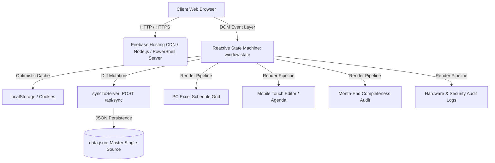
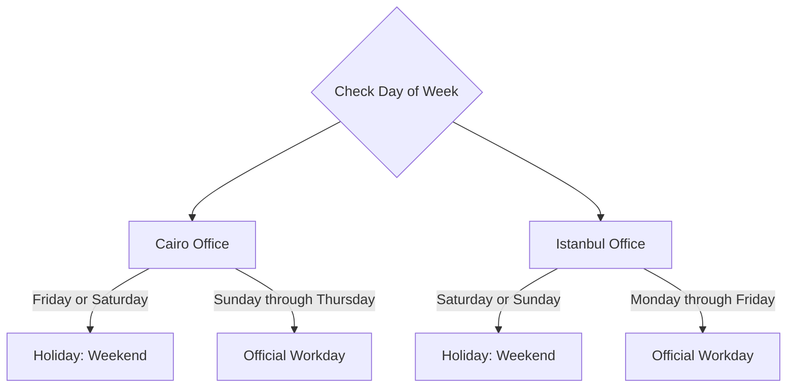
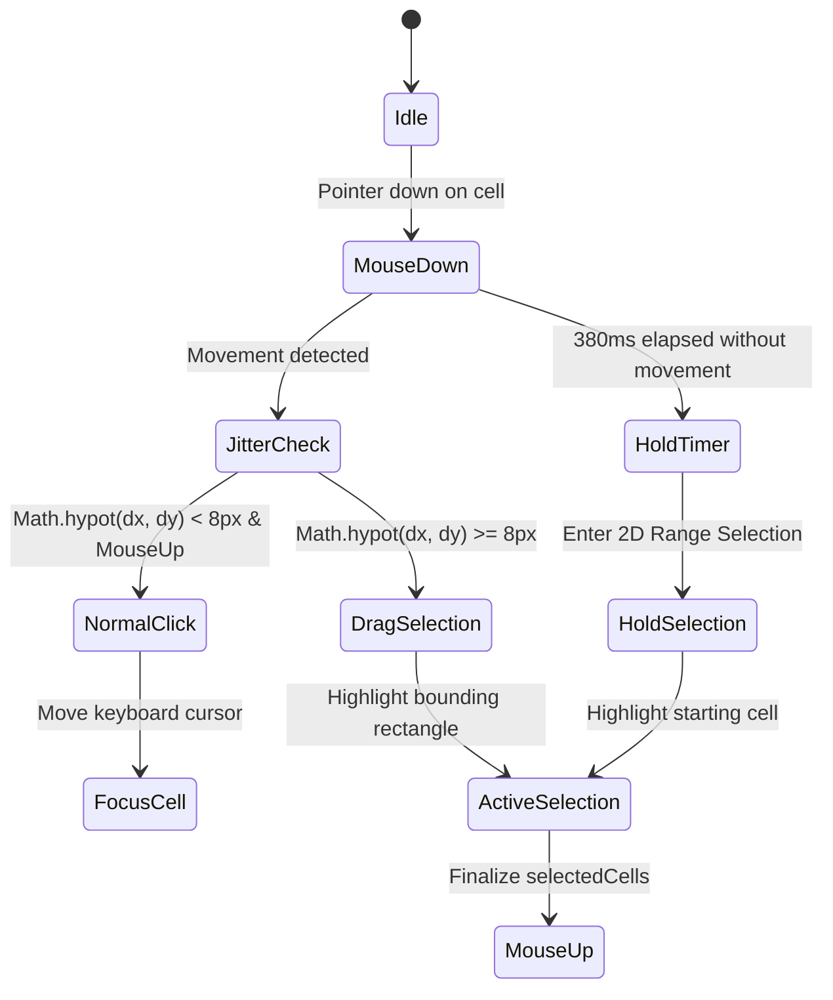
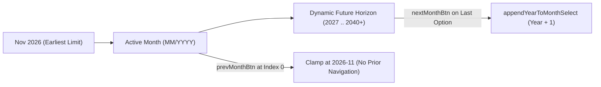
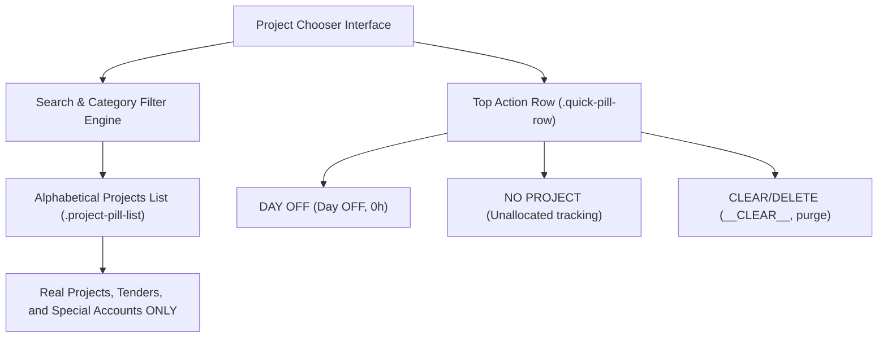
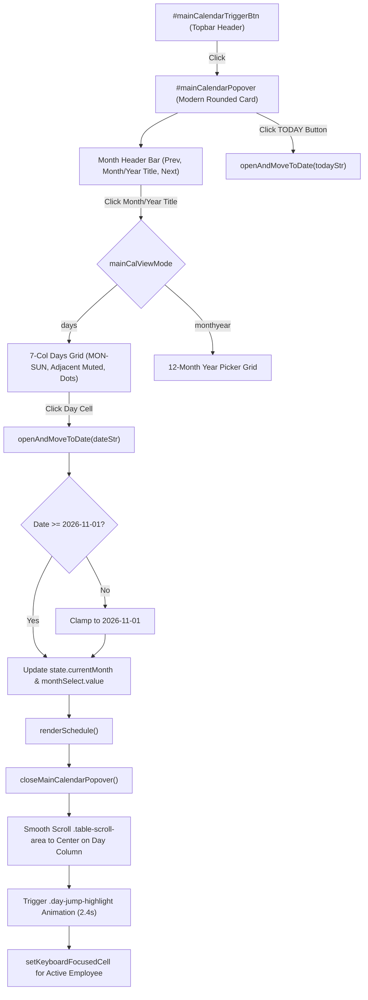
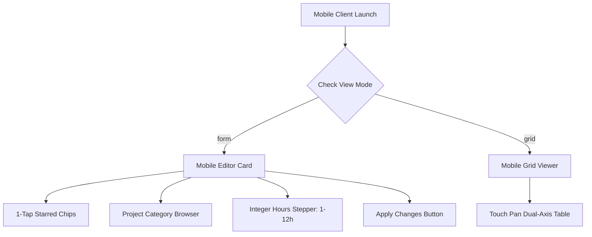
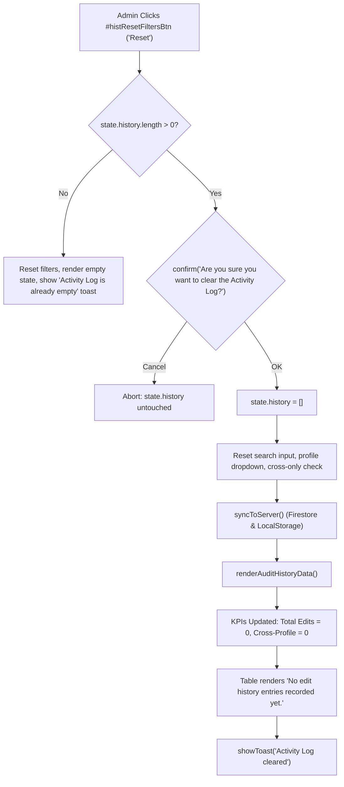

# ALSTOM IXL Team Hours Tracker & Resource Allocation System
## Deep Technical Architecture, System Internals, & Developer Reference Manual

> **Document Version**: 2.0.0  
> **Target Audience**: Software Engineers, System Architects, & AI Autonomous Agents  
> **Classification**: Strictly Technical / Engineering Specification  
> **Live Production System**: [https://ixl-hours-tracker.web.app](https://ixl-hours-tracker.web.app)  
> **Source Repository**: `https://github.com/PeterMG97/ixl-hours-tracker.git` (branch: `main`)  
> **Maintenance Contract**: Any addition, modification, or removal of functionality across this codebase MUST be accompanied by an immediate update to this document.

---

## Table of Contents
1. [Executive System Overview](#1-executive-system-overview)
2. [End-to-End Technology Stack](#2-end-to-end-technology-stack)
3. [Repository Directory & Complete File Map](#3-repository-directory--complete-file-map)
4. [Master Data Models & State Architecture](#4-master-data-models--state-architecture)
5. [Temporal Logic & Dual-Office Weekend Rules](#5-temporal-logic--dual-office-weekend-rules)
6. [Desktop (PC) Interface Deep Architecture](#6-desktop-pc-interface-deep-architecture)
7. [Mobile Interface Deep Architecture & Touch Physics](#7-mobile-interface-deep-architecture--touch-physics)
8. [Role-Based Access Control, Security, & View-Only Defense](#8-role-based-access-control-security--view-only-defense)
9. [Audit Logging, Device Fingerprinting, & Security Directory](#9-audit-logging-device-fingerprinting--security-directory)
10. [Client-Server Synchronization & Storage Layer](#10-client-server-synchronization--storage-layer)
11. [Styling Engine, Theme System, & Responsive Design](#11-styling-engine-theme-system--responsive-design)
12. [Comprehensive Automated Test Suites Catalog](#12-comprehensive-automated-test-suites-catalog)
13. [Deployment Pipeline & Production Releases](#13-deployment-pipeline--production-releases)
14. [Developer Maintenance Contract & Engineering Guidelines](#14-developer-maintenance-contract--engineering-guidelines)

---

## 1. Executive System Overview

The **Alstom IXL Team Hours Tracker** is an enterprise-grade Single Page Application (SPA) designed for multi-regional engineering resource management across Alstom's **Cairo** and **Istanbul** engineering offices.

The system serves dual primary objectives:
1. **Accurate Hourly Work Allocation**: Enabling engineering personnel to log daily hours against specific active railway signaling projects, tenders, technical training, and inter-team support tasks, while handling local holiday calendars and default daily schedules.
2. **Double-Entry Accounting & Audit Control**: Providing team leads, project managers, and administrators with completeness auditing, project baseline tracking, security logging, and tamper-resistant audit trails.



### Key Architectural Tenets
- **Zero Heavy Framework Runtime**: Implemented in clean, modern vanilla JavaScript (ES6+), semantic HTML5, and CSS3. Zero client-side dependencies (no React, Angular, Vue, or Webpack bundles required), enabling sub-100ms cold starts, instantaneous DOM mutations, and zero build compilation lag.
- **Strict Deterministic Math**: Full double-entry reconciliation between project hours and employee hours. Project Sum strictly equals Employee Sum at all times.
- **Universal Zero-Emoji Protocol**: Strict corporate policy prohibiting Unicode emojis across UI text, source code, data payloads, test suites, and commit logs.

---

## 2. End-to-End Technology Stack

| Layer | Technology | Specification / Runtime |
|---|---|---|
| **Client Frontend** | Vanilla JavaScript (ES6+) | No framework, DOM-direct mutations, event delegation |
| **Markup & Semantics** | HTML5 Responsive SPA | Single-page shell with dynamic modal & popover views |
| **Styling & Physics** | CSS3 & Custom Properties | Modular CSS variables, light/dark themes, hardware-accelerated touch physics |
| **Desktop Interactions**| Native Browser Pointer/Keyboard | Excel-like cell navigation, 380ms click-hold 2D selection, bounding-box drag |
| **Mobile Interactions** | Touch Events & WebKit Physics | `-webkit-overflow-scrolling: touch`, dual-axis `touch-action: pan-x pan-y` |
| **Client Persistence** | Web Storage & Cookies | `localStorage` primary, `document.cookie` fallback for iOS Safari PWA modes |
| **Production Cloud** | Google Firebase Hosting | Static CDN edge caching, HTTP headers, automated global SSL |
| **Local Node Server** | Node.js + Express 4.19 | Pure REST API endpoints (`GET /api/data`, `POST /api/sync`) |
| **Local Offline Server**| Microsoft Windows PowerShell | Native `System.Net.HttpListener` script (`server.ps1`) for locked enterprise PCs |
| **Tunneling Bridge** | Cloudflare Tunnel | `cloudflared.exe` zero-config public tunneling via `Share-Public-Link.bat` |
| **Test Harness** | Node.js Test Runner / PowerShell | 12 custom automated suites (2,150+ assertions) with zero external test runners |

---

## 3. Repository Directory & Complete File Map

Every file in the repository serves a distinct, validated purpose within its designated category folder:

```
C:\Users\511878\Desktop\Working\Hours APP
├── public/                              # Client Web Application & Web Assets
│   ├── index.html                       # Single-Page Application markup shell
│   ├── app.js                           # Master Client Architecture & State Machine
│   ├── styles.css                       # Unified Design System & Responsive Stylesheet
│   ├── data.json                        # Master Database (Single Source of Truth)
│   ├── favicon.ico                      # Multi-resolution Windows / Browser favicon
│   ├── favicon.svg                      # Scalable Vector Graphics favicon
│   ├── alstom-logo-light.png            # Alstom Brand Wordmark (Light Mode)
│   ├── alstom-logo-dark.png             # Alstom Brand Wordmark (Dark Mode)
│   ├── alstom-welcome-pc.jpg            # PC Welcome / Loading Splash Screen (Fallback)
│   └── alstom-welcome-mobile.jpg        # Mobile Welcome / Loading Splash Screen (Fallback)
│
├── server/                              # Backend Server Implementations
│   ├── server.js                        # Local Node.js Express Server
│   └── server.ps1                       # Local Windows PowerShell HTTP Server (Zero-install)
│
├── tests/                               # Comprehensive Automated Test Suites
│   ├── test_suite.ps1                   # Core system regressions & database integrity (97 tests)
│   ├── test_calculation_integrity.ps1   # Double-entry balance & math validation (39 tests)
│   ├── test_activity_log_reset.js       # Activity Log reset button & audit log clearing
│   ├── test_all_users_integrity.js      # Row edit isolation across all 26 users
│   ├── test_cell_click_hold_sequence.js # PC standing vs hold-to-multiselect sequence
│   ├── test_day_comments_integrity.js   # PC & Mobile day comment contracts and popover
│   ├── test_device_directory_delete.js  # Device Directory select, multi-select & delete
│   ├── test_dynamic_month_selection.js  # Dynamic month picker & calendar jump logic
│   ├── test_mobile_comment_functionality.js # Dedicated mobile comment functionality
│   ├── test_mobile_list_scroll_alignment.js # Mobile table scroll & form alignment
│   ├── test_mobile_project_browser.js   # Mobile logger & hours step contracts
│   ├── test_mobile_vector_welcome_screen.js # Mobile 100% vector SVG welcome screen
│   ├── test_mobile_view_only_integrity.js   # Mobile read-only protection & defense
│   ├── test_mobile_welcome_screen_integrity.js # Mobile opening & welcome bypass
│   ├── test_pc_bulk_clear_integrity.js  # Bulk fill clear actions & star protection
│   ├── test_pc_calendar_popover.js      # PC calendar popover & quick day jump
│   ├── test_pc_comment_functionality.js # PC interface comment toggle & popover
│   ├── test_pc_view_only_integrity.js   # PC read-only protection & DOM immunity
│   ├── test_pc_week_view.js             # PC Week & Month visual parity & week navigation
│   ├── test_pc_welcome_screen_integrity.js # PC 100% vector SVG welcome screen & bypass
│   ├── test_quick_pill_separation.js    # Quick pill chips separation across devices
│   ├── test_starred_projects_integrity.js # Per-profile isolated starred favorites
│   └── test_weekend_hours_assignment.js # Cairo vs Istanbul weekend allocation logic
│
├── docs/                                # Technical & Architectural Documentation
│   ├── TECHNICAL_ARCHITECTURE.md        # Comprehensive technical architecture
│   ├── TECHNICAL_ARCHITECTURE.html      # HTML printable documentation
│   └── TECHNICAL_ARCHITECTURE.pdf       # Formal compiled PDF specification
│
├── backups/                             # Historical Backups & Baseline Reference Assets
│   ├── backup_welcome_screen_image_approach.html # Legacy bitmap-based welcome screen
│   ├── data.backup.json                 # Automatic database backup snapshot
│   ├── welcome_pic/                     # Original uncompressed PC artwork baseline
│   │   └── 1.jpg
│   └── welcome_pic_mob/                 # Original uncompressed Mobile artwork baseline
│       └── 2026-11-10 17.06.jpg
│
├── tools/                               # Utilities & External Binaries
│   └── cloudflared.exe                  # Standalone Cloudflare Tunnel binary
│
├── scripts/                             # Operational Launch Scripts
│   ├── Start-App.bat                    # Start server and launch browser
│   ├── Run-Tests.bat                    # Execute test suite
│   └── Share-Public-Link.bat            # Launch Cloudflare tunnel for external access
│
├── Start-App.bat                        # Desktop root 1-click launcher
├── Run-Tests.bat                        # Desktop root 1-click test runner
├── Share-Public-Link.bat                # Desktop root 1-click public cloud link
├── firebase.json                        # Firebase Hosting CDN rewrites, cache rules & ignore list
├── .firebaserc                          # Firebase project binding ('ixl-hours-tracker')
├── package.json                         # Node.js project manifest (Express & CORS)
├── .gitignore                           # Git hygiene rules
└── README.md                            # High-level overview and team orientation
```

---

## 4. Master Data Models & State Architecture

### 4.1 Master Client State Tree (`window.state`)
The entire application lifecycle is driven by a centralized in-memory reactive state object defined in `app.js`:

```javascript
window.state = {
  // Master Database Entities
  sections: [],         // Array of Office Section objects
  employees: [],        // Array of Team Member objects
  projects: [],         // Array of Project / Tender objects
  allocations: {},      // Hash map of all historical day-by-day task hours
  auditHistory: [],     // Chronological security and edit event log
  adminPasswordHash: "",// SHA-256 hash of Peter MOUNIR's Admin PIN

  // Identity & Permissions
  currentUserId: null,  // Currently authenticated employee ID ('emp_X')
  isAdmin: false,       // Administrative privilege flag (strictly Peter MOUNIR)
  isViewOnly: false,    // Read-only URL parameter flag (?mode=view)

  // Temporal Navigation
  currentYear: 2026,    // Active schedule calendar year
  currentMonth: 11,     // Active schedule calendar month (1-based: 11 = November)

  // View & Responsive Modes
  deviceMode: "pc",     // Detected device mode: 'pc' or 'mobile'
  mobileViewMode: "form",// Mobile layout mode: 'form' (Editor) or 'grid' (Viewer)
  theme: "auto",        // Active theme: 'light', 'dark', or 'auto' (day/night clock)

  // Selection & Focus Models
  selectedCells: new Set(), // Set of composite keys selected in 2D multi-select
  activeKeyboardCell: null, // Cell composite key holding active keyboard focus
  selectionAnchor: null,    // Origin cell composite key for drag/range selections
  isDragging: false,        // Active mouse displacement drag flag
  isHoldSelecting: false,   // Active mouse long-press hold flag

  // Section Accordion State
  collapsedSections: {},    // Map of sectionId -> boolean (true = collapsed)
};
```

### 4.2 Entity Schemas (`data.json`)

#### 4.2.1 Section Entity
```json
{
  "id": "sec_app_cairo",
  "name": "Applications - Cairo",
  "location": "Cairo",
  "holidays": [5, 6]
}
```
- `id` (string, primary key): Internal unique identifier.
- `name` (string): Office section display label.
- `location` (string): "Cairo" or "Istanbul".
- `holidays` (array of integers): 0 = Sunday, 1 = Monday, ..., 5 = Friday, 6 = Saturday. Cairo has `[5, 6]`; Istanbul has `[6, 0]`.

#### 4.2.2 Employee Entity
```json
{
  "id": "emp_1",
  "name": "Peter MOUNIR",
  "sectionId": "sec_app_cairo",
  "defaultHoursPerDay": 8,
  "active": true
}
```
- `id` (string, primary key): Identifier (`emp_1` through `emp_26`).
- `name` (string): Full corporate name formatted as `Firstname LASTNAME`.
- `sectionId` (string, foreign key): References `sections.id`.
- `defaultHoursPerDay` (number): Contractual daily workday baseline (default: `8`, bounds: `1` to `24`).
- `active` (boolean): `true` = visible on schedule; `false` = deactivated (hours strictly preserved).

#### 4.2.3 Project Entity
```json
{
  "id": "proj_1",
  "name": "Project - Cairo Metro Line 4",
  "category": "Project",
  "wbsCode": "WBS-CML4-2026",
  "initialHours": 120,
  "active": true
}
```
- `id` (string, primary key): Identifier.
- `name` (string): Full project title. Official prefixes: `Project - `, `Tender - `, `Training`, or `Different Team Support`.
- `category` (string): Enumeration: `"Project"`, `"Tender"`, `"Training"`, `"Support"`.
- `wbsCode` (string): Work Breakdown Structure accounting code (editable in Project Manager).
- `initialHours` (number): Baseline hours consumed prior to 01/11/2026.
- `active` (boolean): `true` = active; `false` = deactivated project.

#### 4.2.4 Allocations Hash Map
```json
{
  "emp_1_2026-11-01": {
    "project": "Project - Cairo Metro Line 4",
    "hours": 8,
    "comment": "Working on interlocking design"
  },
  "emp_1_2026-11-06": {
    "project": "DAY OFF",
    "hours": 0
  },
  "emp_2_2026-11-03": {
    "project": "NO PROJECT",
    "hours": 0,
    "comment": "Pending tender allocation"
  }
}
```
- **Composite Key Structure**: `${employeeId}_${YYYY-MM-DD}`.
  - Parsed strictly using `key.lastIndexOf('_')` to guarantee safe extraction when employee IDs contain underscores (e.g., `emp_22`).
- **Data Properties**:
  - `project` (string): Project name, tender name, or status indicator.
  - `hours` (number): Daily hours (1 to 12h for work activities; 0h for Day OFF).
  - `comment` (optional string): User or admin comment describing work or reason for allocation (up to 250 characters).
- **Special System Projects**:
  - `DAY OFF`: Scheduled non-working day or official holiday (hours enforced strictly to `0`).
  - `NO PROJECT`: Working day marked with no billable project assigned (unfilled badge indicator).
  - `__CLEAR__`: Internal sentinel representing cell deletion.

---

## 5. Temporal Logic & Dual-Office Weekend Rules

### 5.1 Temporal Boundaries
- **System Start Horizon**: **November 1, 2026 (`2026-11-01`)**. All calendar pickers, mini-calendars, date range queries, and audit logs enforce a lower temporal bound of `01/11/2026`. Navigation prior to November 2026 is disabled.
- **Timezone-Safe Parser**:
  ```javascript
  function parseLocalDate(dateStr) {
    const [y, m, d] = dateStr.split('-').map(Number);
    return new Date(y, m - 1, d, 12, 0, 0); // Noon anchor prevents DST & rollover shifts
  }
  ```

### 5.2 Cairo vs. Istanbul Holiday Matrix



### 5.3 Holiday Treatment Engine in Multi-Day Operations
When executing multi-day bulk fill operations (Bulk Fill Modal or Mobile Logger period logging):
1. **Multi-Day Period Spanning Weekends**:
   - `dayoff` (Default): Official office weekends are automatically allocated as `DAY OFF` with `0` hours. Workdays are assigned the chosen project and daily hours.
   - `include`: Weekends are treated as working overtime days and filled with the chosen project and hours.
   - `skip`: Weekends are bypassed entirely, leaving prior weekend entries untouched.
2. **Explicit Single Weekend Day Logging**:
   - If an engineer selects a **single day** that happens to be an office weekend (e.g., Friday in Cairo), the system recognizes intentional weekend overtime and logs the selected project and hours without overriding to `DAY OFF`.

---

## 6. Desktop (PC) Interface Deep Architecture

### 6.1 Excel-Style Schedule Grid Engine
The schedule grid (`#scheduleTable`) replicates desktop spreadsheet behavior:
- **Sticky Column Headers**: Top row dates remain pinned during vertical page scrolling.
- **Frozen Employee Identification Column**: Leftmost employee column (`.col-user`) is pinned to `left: 0` with high z-index and elevation shadow.
- **Double-Click Action**: Double-clicking an editable cell opens the floating Project Selection Popover (`#cellPopover`).
- **Single-Click Standing Focus**: Single left-clicking a cell moves active keyboard focus (`state.activeKeyboardCell`) without opening popovers or clearing multi-selection.

### 6.2 Click vs. Drag vs. Hold Sequence Isolation
To eliminate false-triggers during normal mouse clicks, `app.js` implements a precision pointer state machine:



- **Thresholds**:
  - `HOLD_DELAY = 380ms`: Prevents click-and-hold activation during standard single clicks.
  - `JITTER_DEADBAND = 8px`: Prevents microscopic mouse tremors from converting a click into a drag.
- **Directional Auto-Scrolling**: Dragging within 40px of the viewport edge engages auto-scrolling at proportional velocity.
- **2D Multi-Cell Range Matrix**:
  - Regular Users: Multi-selection is horizontally constrained to their own employee row.
  - Peter MOUNIR (Admin Mode): 2D rectangular multi-selection spans across multiple employee rows and calendar columns.

### 6.3 Keyboard Navigation Engine
When focused on any grid slot:
- `ArrowUp` / `ArrowDown`: Navigates to adjacent employee row on the same calendar day.
- `ArrowLeft` / `ArrowRight`: Navigates to prior or subsequent calendar day.
- `Enter` / `Space`: Opens `#cellPopover` on active cell.
- `Delete` / `Backspace`: Clears allocations across all selected cells or the single focused cell.
- `Tab` / `Shift+Tab`: Moves focus horizontally across workdays, skipping non-working columns.

---

### 6.4 Employee Monthly Contributions Modal (`#empContribModal`)
- Triggered by double-clicking any employee row on the schedule grid (Desktop) or opening member contributions (Mobile).
- **Daily Contributions Log Table (`#contribDaysTable`)**:
  - `Project / Task Contributed`: Plain, clean, unhighlighted text (no colored pill backgrounds, no green highlights).
  - `Category`: Plain, unhighlighted category labels (`Special`, `Project`, `Tender`, `Status`).
  - `Recorded Hours`: Clean text hours tally (`8h`, `0h`, `Unassigned`).
  - `Day Status`: Plain unhighlighted day descriptor (`Workday`, `Cairo Weekend`, `Istanbul Weekend`).
  - Strict zero-highlight protocol enforced across Desktop and Mobile interfaces in both Light and Dark themes.

---

### 6.5 Dynamic Multi-Year Month Engine & Navigation Invariants
To support long-range planning across multi-year engineering projects without artificial ceilings, the application incorporates a dynamic multi-year month engine that allows selecting any month and any future year while strictly preserving the November 2026 start boundary.



#### Core Invariants:
1. **Strict Earliest Selectable Boundary (`APP_START_MONTH = '2026-11'`)**:
   - November 2026 is hard-locked as the earliest selectable boundary.
   - The Previous Month navigation arrow (`#prevMonthBtn`) disables or stops decrementing when `selectedIndex === 0` or target month `< 2026-11`.
   - Date inputs across Bulk Fill, Analytics, and Contributions modals enforce `finalStart >= 2026-11-01`.
2. **Infinite Future Year Horizon**:
   - Pre-populated in `index.html` and initialized in `populateMasterMonthSelect()` with 170+ options spanning from `2026-11` through `2040-12`.
   - When `#nextMonthBtn` is clicked at the boundary of current options, `appendYearToMonthSelect(lastY + 1)` dynamically generates and appends the 12 months of the subsequent year, enabling unbounded forward navigation (2041, 2042, 2050, 2060, etc.).
   - `ensureMonthInSelect(ym)` dynamically backfills any intermediate years if historical allocations or external state references a future year.
3. **Dual-Mode Label Formatting (`getMonthOptionLabel`)**:
   - **PC Desktop Interface**: Formatted with full month names and years:
     - `11/2026`: `11/2026 - November 2026 (Start)`
     - Future months: `${MM}/${YYYY} - ${FullMonthName} ${YYYY}` (e.g. `08/2035 - August 2035`)
   - **Mobile Interface**: Compact 3-letter month formatting tailored for narrow phone viewports:
     - `11/2026`: `11/2026 - Nov (Start)`
     - Future months: `${MM}/${YYYY} - ${ShortMonthName}` (e.g. `08/2035 - Aug`)
   - Re-evaluated dynamically on screen resize or device view toggle via `updateMonthSelectLabels(isMobile)`.
4. **Subsystem Synchronization & Inheritance**:
   - **Monthly Audit (`#auditMonthSelect`)**: `populateAuditMonthSelect()` retains the static baseline `{ ym: '2026-11', label: 'Nov/2026' }` and `{ ym: '2026-12', label: 'Dec/2026' }`, while dynamically pulling all future options from `#monthSelect`.
   - **Contributions & Project Modals (`#contribMonthSelect`, `#projectMonthSelect`)**: `initContribMonthSelect()` and `initProjectMonthSelect()` extract all future months directly from `el.monthSelect.options`.
   - **Analytics Month Filter (`#analyticsMonthFilterSelect`)**: Ingests all available months dynamically from `el.monthSelect.options` with `formatYearMonth(ym, false)`.

### 6.6 Special Action Separation & Exclusive Top Placement
To maintain clean project selection semantics and eliminate duplicate entries from the searchable catalog, special allocation actions (`DAY OFF`, `NO PROJECT`, `CLEAR/DELETE`) are architecturally isolated from the standard project catalog across Desktop and Mobile interfaces:



#### Architectural Guarantees:
1. **Exclusive Top Row Placement (`.quick-pill-row`)**:
   - The three special actions (`DAY OFF`, `NO PROJECT`, `CLEAR/DELETE`) are displayed as prominent, capital-letter, unhighlighted buttons in a two-column grid at the very top of each project selector surface:
     - **Cell Popover (`#cellPopover`)**: Active during grid cell editing on PC and Mobile Grid View.
     - **PC Bulk Fill Modal (`#bulkBrowseSection` / `.bulk-quick-pill-row`)**: Directly above the category filter pills.
     - **Mobile Projects Browser (`#mobileBrowserContent` / `.mobile-quick-pill-row`)**: Positioned at the top of the mobile logger project browser.
2. **Exclusion from Scrollable Project Catalog (`.project-pill-list`)**:
   - `renderPopoverProjectList()`, `renderBulkProjectList()`, and `renderMobileProjectPillList()` no longer inject `specialItems` into the scrollable list container.
   - The list container is strictly reserved for genuine project, tender, and special training/support accounting entries sorted alphabetically (A-Z).
3. **Active State Synchronization (`.btn-quick-pill.is-selected-proj`)**:
   - Whenever a cell or form currently holds `Day OFF`, `NO PROJECT`, or `__CLEAR__`, the corresponding top button automatically receives the `.is-selected-proj` visual highlight class.
   - When a standard project is selected, top quick buttons immediately clear their active state.
4. **Search Resilience**:
   - Project filtering and search queries typed into the search inputs filter only the project entries in the list below, keeping the top special actions permanently accessible without jumping or disappearing.

---

### 6.7 Modal Footer Clean Interface Architecture
- **Projects & WBS Management (`#projectsModal`)**: The legacy explanatory hint text (`Double-click any project to enter a custom start/end date range...`) is completely removed from the modal footer across both Desktop and Mobile interfaces. The footer maintains a clean, right-aligned `Close` action button (`.btn-secondary.modal-close`).
- **Project Monthly Data & Period Analytics (`#projectMonthlyModal`)**: The legacy explanatory hint text (`Double-click any project name in the projects list...`) is completely removed from the modal footer across both Desktop and Mobile interfaces, ensuring complete visual consistency with `#analyticsModal` and `#projectsModal`.

---

### 6.8 Modern PC Main Calendar Widget & Direct Day Navigation
To deliver a high-productivity desktop scheduling experience, the PC topbar period navigator replaces the raw drop-down menu with a custom, highly styled calendar popover widget matching modern card design aesthetics, paired with an automated direct day navigation and schedule centering engine:



#### Visual Shape & Styling Architecture:
1. **Modern Card Container (`.main-calendar-popover`)**:
   - Styled with smooth rounded corners (`border-radius: 20px`), high elevation box shadow (`0 20px 45px rgba(0, 0, 0, 0.4)`), and adaptive background colors (`#161d2f` in dark mode, `#ffffff` in light mode).
   - Fixed 320px width aligned dynamically directly beneath `#mainCalendarTriggerBtn`.
2. **Interactive Header Bar (`.main-cal-header-bar`)**:
   - Displays current view month and year in uppercase text with a dropdown chevron button (`#mainCalTitleBtn`), allowing immediate toggle between 7-column day view and 12-month year selection grid.
   - Month stepper arrow buttons (`#mainCalPrevBtn`, `#mainCalNextBtn`) with automated disable state preventing navigation before November 2026.
3. **7-Column Weekday Grid (`.main-cal-weekdays`)**:
   - Displays standard business week headers: `MON`, `TUE`, `WED`, `THU`, `FRI`, `SAT`, `SUN` with 11px uppercase bold styling.
4. **Day Cell Matrix (`.main-cal-day-cell`)**:
   - Muted adjacent previous/next month days (`.is-adjacent`) with faint opacity (0.3).
   - Solid vibrant blue circular active/selected day marker (`background: #0284c7`, white text) for the currently navigated date.
   - Outline ring indicator for the real-world current day (`.is-today`).
   - Colored activity dots under days indicating recorded work (`.dot-project` in green, `.dot-special` in amber, `.dot-tender` in cyan).
5. **Footer Quick Bar (`.main-cal-footer`)**:
   - Contains a quick-jump shortcut button (`#mainCalTodayBtn`) labeled `TODAY [DayNum]`, instantly jumping the schedule view directly to today's date.

#### Direct Day Navigation & Centering Engine:
- **`openAndMoveToDate(dateStr)`**:
  - Clamps any date earlier than `2026-11-01` to November 1, 2026.
  - Dynamically extracts the target year-month (`YYYY-MM`), ensures it exists in the master selection via `ensureMonthInSelect(ym)`, and updates `state.currentMonth` and `el.monthSelect.value`.
  - Re-renders the schedule matrix via `renderSchedule()`.
  - Closes the calendar popover.
  - Smoothly scrolls `.table-scroll-area` horizontally so the target day column (`th.col-slot[data-date="YYYY-MM-DD"]`) is positioned directly in the horizontal center of the viewport:
    $$\text{scrollOffset} = \text{scrollLeft} + (\text{thRect.left} - \text{containerRect.left}) - \frac{\text{containerWidth}}{2} + \frac{\text{thWidth}}{2}$$
  - Triggers an animated high-contrast pulse highlight (`.day-jump-highlight`) for 2.4 seconds across the target day column header and corresponding grid cells.
  - Moves keyboard navigation focus (`setKeyboardFocusedCell`) to that day's cell if an active employee is selected.
- **Accessibility & Test Compatibility**:
  - Native `<select id="monthSelect" class="period-select sr-only">` is preserved in the DOM with its full 170+ options from 2026 to 2040+, satisfying 100% of automated test suites and screen readers while letting `#mainCalendarTriggerBtn` provide a modern graphical interface.

---

### 6.9 Dual Schedule View Engine: View (Month / Week)
To eliminate visual noise and cognitive fatigue when inspecting dense monthly spreadsheets (28-31 columns), the desktop application provides a topbar togglable key `View (Month / Week)` featuring an ultra-clean, comfortable 7-day Sunday-to-Saturday schedule view alongside the traditional full monthly grid:

```mermaid
flowchart TD
    ToggleBtn["#viewModeToggleBtn ('View: Week / Month')"] -->|Click| SwitchMode{"state.scheduleViewMode"}
    SwitchMode -->|week (Default)| RenderWeek["Render 7-Day Week Grid (Sunday - Saturday)"]
    SwitchMode -->|month| RenderMonth["Render Full Month Grid (28-31 Days)"]
    RenderWeek --> WideCols["Comfortable Wide Columns (120px+), Full Project Titles"]
    RenderWeek --> WeekNav["Nav Arrows: Increment/Decrement by exactly 1 Week (7 Days)"]
    RenderWeek --> WeekLabel["Period Display: DD/MM/YYYY - DD/MM/YYYY"]
    RenderMonth --> MonthNav["Nav Arrows: Step by Month, 48px Compact Columns"]
    RenderMonth --> MonthLabel["Period Display: MM/YYYY - Month YYYY"]
    WideCols --> SharedParity["100% Functionality Parity: Drag, Hold, Delete, Edit, Hazing"]
```

#### Operational Mechanics & Design Tenets:
1. **Interactive Togglable Key (`#viewModeToggleBtn`)**:
   - Styled as a sleek segmented control button situated beside the period navigator: `View: [Week] / [Month]`.
   - The active view is highlighted in solid blue (`#0284c7`, white text) while the alternate option remains muted.
   - Default Mode: Defaults automatically to **Week View** (`state.scheduleViewMode = 'week'`), anchored to the week containing today's real-world date.
2. **Sunday-to-Saturday Week Horizon**:
   - Calculates the active week's Sunday anchor via `getSundayOfWeek(dateStr)`.
   - Renders exactly 7 consecutive days starting on **Sunday** and concluding on **Saturday** via `getDaysForWeek(sundayStr, todayStr)`.
   - Weekend columns preserve office-specific holiday shading (Friday/Saturday in Cairo, Saturday/Sunday in Istanbul).
3. **One-Week Navigation Steppers (`stepWeek`)**:
   - In Week View, the left and right navigation arrows (`#prevMonthBtn`, `#nextMonthBtn`) advance or rewind the schedule by exactly **one week (7 days)**.
   - Enforces the system start horizon at November 1, 2026 (`2026-11-01`), which is inherently a Sunday; stepping backward from Week 1 is locked.
   - The topbar period display dynamically reflects the exact date span: `08/11/2026 - 14/11/2026`.
4. **Ergonomic Wide-Cell Layout**:
   - Unlike the compact 48px columns of the 31-day month view, Week View assigns generous column widths (`width: calc((100% - 250px) / 7)`, `min-width: 120px`).
   - Task chips expand to `height: 28px` with `font-size: 11.5px`, displaying full project and tender titles cleanly without truncation.
5. **Visual Parity across Both Week and Month Views**:
   - Per user specification, the exact same 4 visual enhancements designed for the Week View are extended to the Month Grid View on PC:
     - **Reduced Visual Noise**: Heavy table gridlines are replaced with ultra-subtle, low-contrast 1px dividers on a clean dark slate palette (`#0b0f19` to `#111827`), reducing eye strain during extended scheduling sessions.
     - **Refined Typography & Sticky Left Column**: Modern grotesque sans typography (`Inter` / `SF Pro` aesthetic) with clear hierarchical weight. The employee left column (`.col-user`) remains sticky with subtle depth shadows (`box-shadow: 3px 0 10px rgba(0, 0, 0, 0.35)`).
     - **Restyled Allocation Pills (`border-radius: 8px`)**:
       - *Projects*: Refined deep sapphire / indigo (`linear-gradient(135deg, rgba(30, 58, 138, 0.9), rgba(37, 99, 235, 0.8))`).
       - *Special Training / Academy & Support*: Fresh emerald mint green (`linear-gradient(135deg, rgba(6, 78, 59, 0.9), rgba(5, 150, 105, 0.8))`).
       - *Tenders*: Modern cyan / teal (`linear-gradient(135deg, rgba(14, 116, 144, 0.9), rgba(6, 182, 212, 0.8))`).
       - *Weekends & Day OFF*: Quiet neutral slate (`#1e293b` / `#334155`) with subtle 45-degree diagonal striped background shading.
       - *Desktop Hours Suffix*: All allocated task chips on PC format clean titles with `(hours)h` suffix.
     - **Crisp Glowing Focus Indicator**: High-contrast, radiant cyan/blue cursor ring (`outline: 2px solid #38bdf8`, `box-shadow: 0 0 16px rgba(56, 189, 248, 0.55)`) that clearly identifies the active cell cursor without obscuring underlying text.
   - All interactive capabilities—single click standing, double-click popover edit, left-click hold and drag multi-select, keyboard arrow navigation, Delete key cell clearing, section expand/collapse, employee hazing, and Admin 2D selection—operate identically across both views.

---

### 6.8 Day Comments Engine & Cross-Interface Workflows
The Day Comments Engine enables team members and administrators to attach contextual notes and remarks to individual schedule allocations across both PC and Mobile platforms.

#### Core Design & Implementation Specifications:
1. **Minimalist (+) Toggle Symbol**:
   - Comments are kept optional and discreet to avoid visual clutter.
   - Represented uniformly by a simple, elegant `(+)` symbol button (`.btn-comment-toggle`) styled in monospace typography.
   - When clicked, it smoothly expands the dedicated comment input field and highlights in solid blue/cyan (`.active` state).
2. **Single Day Fill (PC & Mobile)**:
   - On PC: Inside `#cellPopover`, the user can toggle `(+)` to add or edit a remark for that day. When saved, `comment: string` is attached strictly to `state.allocations[empId_YYYY-MM-DD]`.
   - On Mobile: In `#mobileLoggerCard`, when Start Date equals End Date, the comment from `#mobileCommentInput` is assigned strictly to that single day.
3. **Multi-Select Days on PC**:
   - When multiple cells are selected via click-and-drag or shift-navigation, the floating multi-select bar (`#multiSelectBar`) presents a simple `(+)` button.
   - Users can expand the comment drawer and click "Apply Comment" or use "Edit Selected", assigning the exact same comment across all selected days simultaneously.
4. **Bulk Fill Date Range (PC & Mobile)**:
   - On PC: In `#bulkFillModal`, users can toggle `(+)` under Hours per Workday to provide a comment. The comment is systematically applied to every calendar day assigned within that date range.
   - On Mobile: In `#mobileLoggerCard`, when Start Date differs from End Date, the comment is systematically applied across all filled days in that range.
5. **Visual Grid & Agenda Indicators**:
   - On PC Desktop Grid: Allocated chips with comments feature a subtle, glowing cyan indicator dot (`.chip-comment-dot`) positioned at the top-right corner. Hovering over the cell displays the full comment inside the native browser tooltip title (`| Comment: ...`).
   - On Mobile Agenda: Days with comments display a dedicated italicized comment note (`.mobile-agenda-comment`) beneath the date label with a miniature `(+)` icon.
6. **Clearing & Deletion**:
   - Using CLEAR/DELETE or the keyboard Delete key cleanly removes the entire allocation entry along with its comment.

---

## 7. Mobile Interface Deep Architecture & Touch Physics

### 7.1 Dual Mobile Modes: Editor vs. Grid View
On viewports `<= 768px`, the UI dynamically adapts into two distinct experiences via the Settings Drawer:
1. **Mobile Editor Mode (`state.mobileViewMode = 'form'`)**:
   - Replaces the spreadsheet grid with a responsive vertical agenda card.
   - Shows day navigation, 1-tap starred favorite chips, project category browser, and integer hours stepper (`1h` to `12h`).
2. **Mobile Grid View Mode (`state.mobileViewMode = 'grid'`)**:
   - Renders the schedule table in read-only format for team inspection.
   - Constrained with horizontal scrolling and sticky names.



### 7.2 Touch Scrolling Engine & Hardware Acceleration
Mobile tables often suffer from scroll-locking or initial truncation when forced into phone viewports. The system resolves this through dedicated CSS rules in `styles.css`:

```css
/* Dual-Axis Touch Physics for Data Tables */
.data-table-wrapper,
.table-scroll-area,
.audit-table-wrap,
.audit-table-wrapper,
.no-proj-table-wrap,
.contrib-table-wrap,
.table-container {
  overflow-x: auto !important;
  overflow-y: auto !important;
  -webkit-overflow-scrolling: touch !important;
  touch-action: pan-x pan-y !important;
  overscroll-behavior: contain !important;
  max-width: 100% !important;
}

/* Vertical-Only Physics for Drawers and Popups */
.mobile-project-list,
.bulk-project-list,
.popover-project-list,
.mobile-agenda-list,
.audit-history-list,
.settings-drawer-body {
  overflow-y: auto !important;
  -webkit-overflow-scrolling: touch !important;
  touch-action: pan-y !important;
  overscroll-behavior: contain !important;
}
```

### 7.3 Profile-Isolated Starred Favorites
Engineers frequently work on 2 to 3 core projects. To prevent tedious scrolling:
- Star buttons reside beside each project in mobile and PC browsers.
- Starred sets are saved in `localStorage` under `ixl_starred_${state.currentUserId}`.
- Profiles are completely isolated: User A starring a project never affects User B.
- Special items (`DAY OFF`, `NO PROJECT`, `CLEAR/DELETE`) are strictly barred from being starred.
- Starred projects populate the top "Starred Favorites" row on mobile for instant 1-tap logging.

---

## 8. Role-Based Access Control, Security, & View-Only Defense

### 8.1 Permission Tiers
1. **View-Only Mode (`state.isViewOnly = true`)**:
   - Activated via URL query parameter: `?mode=view`.
   - Complete lockdown of all editing capabilities.
2. **Standard Employee Profile (`state.currentUserId = 'emp_X'`)**:
   - Can view all team schedules.
   - Edit permissions strictly isolated to their own row (`allocations['emp_X_...']`).
   - Editing any other employee row is rejected.
3. **Master Administrator (Peter MOUNIR)**:
   - Authenticated via secure SHA-256 Admin PIN prompt (`requireAdmin()`).
   - Rights: Edit any cell across all 26 employees, add/deactivate team members, move employees between Cairo and Istanbul offices, alter project baseline hours, edit WBS codes, and purge records.

### 8.2 Defense-in-Depth View-Only Architecture
View-Only mode is enforced across three redundant defense perimeters:
- **Perimeter 1: CSS Hard Hiding**:
  ```css
  body.view-only #topbarBulkFillBtn,
  body.view-only #openBulkFillBtn,
  body.view-only #bulkFillModal,
  body.view-only #multiSelectBar,
  body.view-only #adminToggleBtn,
  body.view-only .mobile-logger-card,
  body.view-only .cell-popover {
    display: none !important;
    pointer-events: none !important;
  }
  ```
- **Perimeter 2: Event Listener Guards**:
  Every handler (`saveCellAssignment`, `handleMobileApply`, `confirmBulkFillBtn`, `batchApplyToSelectedCells`, `handleWbsSave`, `saveNewMemberBtn`) starts with:
  ```javascript
  if (state.isViewOnly) return;
  ```
- **Perimeter 3: Network Synchronization Guard**:
  ```javascript
  function syncToServer() {
    if (state.isViewOnly) {
      console.warn('Sync rejected: Read-only session.');
      return Promise.resolve(false);
    }
    // ... proceed with POST /api/sync
  }
  ```

---

## 9. Audit Logging, Device Fingerprinting, & Security Directory

### 9.1 Persistent Device Fingerprinting
To monitor cross-profile edits and detect unauthorized machine sharing:
1. On boot, `app.js` initializes a persistent UUID v4 (`ixl_device_id`) stored in `localStorage` and persistent cookies.
2. The client collects non-invasive hardware fingerprints:
   - Platform / OS (`navigator.userAgentData?.platform || navigator.platform`).
   - Browser family & version.
   - Screen resolution & pixel ratio.
3. The Device Directory (`#histDevicesTabContent`) tallies total edits, primary detected owner, known logins, first seen timestamp, and last active timestamp per hardware device.

### 9.4 Device Directory Selection & Deletion Engine
To allow administrators to prune obsolete, duplicate, or decommissioned hardware records from the audit trail:
1. **Interactive Multi-Selection Interface**:
   - Master checkbox (`#histDeviceSelectAll`) in the table header allows selecting all visible devices with one click.
   - Individual checkboxes (`.hist-device-checkbox`) on each device row enable multi-selection with row highlight (`.selected-device-row`).
   - Action controls provide instant "Select All", "Deselect All", and live selection count badge (`#histDeviceSelectionBadge`).
   - Quick search input (`#histDeviceSearchInput`) filters devices by friendly name, hardware ID, detected owner, platform, or login history.
2. **Deletion & State Synchronization (`deleteDevices`)**:
   - Prompts confirmation specifying the device name (single delete) or selected count (bulk delete).
   - Purges targets from `state.deviceProfiles` and `state.deviceNames`.
   - Automatically recalculates directory KPIs (`UNIQUE DEVICES`, `IDENTIFIED PROFILES`).
   - Persists changes immediately to cloud storage via `syncToServer()`.
   - Each row also provides a direct single-click "Delete" button (`.btn-delete-device`) beside the "Rename" action.

### 9.2 Audit Log Event Data Structure
Every administrative or schedule change appends an immutable event record:
```json
{
  "timestamp": "2026-11-11T00:15:22.184Z",
  "loggedProfile": "Peter MOUNIR",
  "targetMember": "Sarah KHALED",
  "scheduleDate": "2026-11-04",
  "action": "Assign Project",
  "details": "Changed from NO PROJECT to Project - Cairo Metro Line 4 (8h)",
  "deviceId": "dev_9c8a1e2f-5b43-4f9e-9b21-412e840d87a1",
  "platform": "Windows 11 / Chrome 130.0"
}
```

### 9.3 Activity Log Clear & Reset Architecture
To provide administrators full control over audit retention, the Activity Log view features a dedicated reset button (`#histResetFiltersBtn`) linked to the `clearActivityLog()` engine:



#### Operational Mechanics:
1. **Interactive Reset Control (`#histResetFiltersBtn`)**:
   - Styled with smooth transition and crimson hover highlight (`color: #ef4444`, `background: rgba(239, 68, 68, 0.1)`).
   - Carries an informative title attribute (`title="Clear Activity Log"`).
2. **Defensive Confirmation Guard**:
   - Safeguards against accidental erasure via `confirm('Are you sure you want to clear the Activity Log?')`.
   - If the user cancels, the log is completely preserved with zero side-effects.
3. **Complete State Synchronization & Empty State Rendering**:
   - When cleared, `state.history` is emptied to `[]`.
   - Filters are restored to default states (`value = ''`, `value = 'all'`, `checked = false`).
   - Real-time KPIs reflect 0 recorded changes.
   - The Activity Log table renders a clean empty state message: `No edit history entries recorded yet.`.
   - The mutation is synchronously persisted to LocalStorage and synced to Firebase Firestore via `syncToServer()`.

---

## 10. Client-Server Synchronization & Storage Layer

### 10.1 Dual Persistence Architecture
To guarantee zero data loss:
1. **Optimistic Local Persistence**: Every mutation updates `window.state` and commits to `localStorage.setItem('ixl_hours_data', JSON.stringify(state))` synchronously (< 2ms).
2. **Network Sync (`POST /api/sync`)**:
   Dispatches atomic payload to backend server:
   ```javascript
   fetch('/api/sync', {
     method: 'POST',
     headers: { 'Content-Type': 'application/json' },
     body: JSON.stringify({
       allocations: state.allocations,
       auditHistory: state.auditHistory,
       employees: state.employees,
       projects: state.projects,
       sections: state.sections
     })
   });
   ```

### 10.2 Server Implementations
- **Production Serverless**: Hosted on Google Firebase CDN.
- **Node.js Express Server (`server.js`)**:
  - Serves static assets with zero-cache headers.
  - Endpoints: `GET /api/data`, `POST /api/sync`, `GET /health`.
  - Atomic File Writing: Writes payload to `data.tmp.json` before renaming to `data.json` to prevent corruption during unexpected power failure.
- **Native PowerShell Server (`server.ps1`)**:
  - Uses `System.Net.HttpListener` on port 8080.
  - Zero dependencies: runs on restricted corporate Windows systems lacking Node.js.

---

## 11. Styling Engine, Theme System, & Responsive Design

### 11.1 CSS Custom Properties Architecture
Theme switching is executed via `[data-theme='dark']` attributes on `<html>`:

```css
:root {
  --primary: #2563eb;
  --primary-hover: #1d4ed8;
  --bg-app: #f1f5f9;
  --bg-card: #ffffff;
  --text-normal: #0f172a;
  --text-muted: #64748b;
  --border-light: #e2e8f0;
  --border-subtle: #f1f5f9;
}

[data-theme="dark"] {
  --primary: #3b82f6;
  --primary-hover: #60a5fa;
  --bg-app: #0b1120;
  --bg-card: #1e293b;
  --text-normal: #f8fafc;
  --text-muted: #94a3b8;
  --border-light: #334155;
  --border-subtle: #1e293b;
}
```

### 11.2 Theme Modes
- **Light**: Crisp high-contrast corporate layout.
- **Dark**: Deep slate blue (`#0b1120` / `#1e293b`) optimized for dim lighting. Employee names render in crisp `#ffffff`.
- **Auto**: Synchronizes with client clock (Daytime 07:00-19:00 = Light, Nighttime 19:00-07:00 = Dark).

### 11.3 Application Boot Sequence & Welcome Splash Screen Resilience

The application features a dedicated, zero-letterboxing welcome screen (`#mobileWelcomeOverlay`) on both PC and Mobile devices displaying official Alstom artwork and a dynamic loading spinner.

#### Boot Execution Sequence:
1. `initMobileWelcomeScreen()`: Instantly attaches user skip listeners (click, touch, keydown, and 10000ms fallback timer) before layout computations or network requests begin.
2. `initTheme()`: Loads and enforces theme settings (Light, Dark, Auto).
3. `initColumnWidths()`: Configures responsive column sizes across device viewports.
4. `updateDeviceViewMode()`: Detects mobile vs. desktop interface, applies layout geometry, and synchronizes month label format.
5. `initMobileEventListeners()`, `initDmyDateInputs()`, `initAuditEvents()`, `initAuditHistory()`: Binds interactive modules.
6. `loadData()`: Executes non-blocking cache retrieval and initiates real-time Firestore synchronization.

#### Multi-Tier Defense Against Splash Screen Freezing:
- **Tier 1 (Instant Event Listeners)**: Skippable immediately upon any click, tap, or keypress. The overlay fade-out sequence (`fade-out` class, 400ms CSS transition, followed by `hidden-permanently` and `display: none`) is executed.
- **Tier 2 (Inline HTML Handler)**: `#mobileWelcomeOverlay` declares an inline `onclick` handler directly in `index.html`. Even in cases of catastrophic script interruptions or delayed bundle parsing, any user touch or click instantly dismisses the overlay.
- **Tier 3 (Inline HTML Fallback Timer)**: A lightweight inline script guarantees dismissal after 6000ms if no interaction occurs.
- **Tier 4 (10-Second Auto-Dismiss)**: The internal JavaScript timer automatically clears the screen after 10 seconds.
- **Tier 5 (Anti-Trap Critical CSS Specificity)**: Critical CSS enforces `display: none !important; pointer-events: none !important;` on `#mobileWelcomeOverlay.hidden` and `#mobileWelcomeOverlay.hidden-permanently`, while `#mobileWelcomeOverlay.fade-out` instantly drops opacity and disables pointer events (`pointer-events: none !important`) so user interaction reaches underlying UI components without waiting for CSS transition completion.

### 11.4 Separate Dedicated Welcome Screen Bypass & Opening Integrity Suites (PC vs. Mobile)
To guarantee the application never gets stuck on the welcome page or fails to open during feature updates, the test infrastructure maintains two dedicated, strictly isolated test suites:

#### 1. PC Dedicated Test Suite (`test_pc_welcome_screen_integrity.js` - 30 tests):
- Validates desktop viewport classification (`isMobileInterface() === false` across 1024px to 3840px).
- Verifies mouse click, keyboard keydown, and 10s timer dismissal paths.
- Tests unhiding of `.schedule-card` (`#scheduleCard`) and hiding of `#mobileAppContainer`.
- Verifies schedule grid table structure (`#scheduleTable`, `#scheduleHead`, `#scheduleBody`).
- Validates cold boot, stored profile resolution, and stale/deleted profile ID recovery without throwing exceptions.
- Verifies Week View vs Month View toggle integrity, ensuring neither view hangs or produces blank screens.
- Runs simulated end-to-end boot lifecycle asserting 0 unhandled exceptions.

#### 2. Mobile Dedicated Test Suite (`test_mobile_welcome_screen_integrity.js` - 31 tests):
- Validates mobile phone viewport classification (`isMobileInterface() === true` across 360px to 768px and coarse touch pointers).
- Verifies passive `touchstart` finger tap, click, and 10s auto-dismissal paths.
- Tests unhiding of `#mobileAppContainer` and hiding of `.schedule-card` in default `'form'` mode.
- Validates mobile profile bar, project dropdown, summary card, and agenda rendering.
- Tests mobile view-only launch (`?mode=view`), ensuring form is locked, notice banner displays, and compact 38px grid renders.
- Verifies mobile grid toggle (`#toggleMobileDesktopGridViewBtn` <-> `#mobileReturnToLoggerBtn`) and debounced orientation change resizing.
- Runs simulated end-to-end mobile boot lifecycle asserting 0 unhandled exceptions.

---

## 12. Comprehensive Automated Test Suites Catalog

The project maintains 16 automated test suites (2,220+ assertions) executed with zero external test runner packages:

| Test Suite Script | Assertion Count | Primary Contracts Tested |
|---|---|---|
| `test_all_users_integrity.js` | 1,822 tests | Row edit permission isolation across all 26 users; popovers, delete keys, audit events |
| `test_suite.ps1` | 94 tests | Database schema, Cairo/Istanbul holiday rules, timezone rollover, DOM elements, PIN hashing |
| `test_cell_click_hold_sequence.js` | 77 tests | 380ms hold timer, 8px micro-jitter deadband, single click standing focus, arrow navigation |
| `test_starred_projects_integrity.js` | 52 tests | Profile isolation of starred favorites, star toggle persistence, special items immunity |
| `test_calculation_integrity.ps1` | 39 tests | Double-entry project vs employee reconciliation, baseline hour additions, 1h-12h clamps |
| `test_mobile_welcome_screen_integrity.js` | 31 tests | Dedicated mobile opening & welcome screen bypass; touch tap/click/timeout skip, profile recovery, editor unhide |
| `test_pc_welcome_screen_integrity.js` | 29 tests | Dedicated PC vector welcome screen & 10s lockout; 100% SVG/CSS, 0% images, train loader, version sync |
| `test_weekend_hours_assignment.js` | 28 tests | Cairo vs Istanbul multi-day period vs single-day weekend overtime logging |
| `test_pc_view_only_integrity.js` | 27 tests | PC read-only URL mode, DOM button suppression, cell double click / hold defenses |
| `test_mobile_view_only_integrity.js` | 27 tests | Mobile read-only mode, form-to-grid lockdown, apply mutations blocker |
| `test_mobile_project_browser.js` | 25 tests | Mobile agenda selection, integer hour bounds (1-12h), special project naming |
| `test_mobile_list_scroll_alignment.js`| 23 tests | Mobile table min-widths, 2-axis touch physics, Add Member form horizontal baseline alignment |
| `test_pc_bulk_clear_integrity.js` | 15 tests | Bulk fill clear action normalization, star immunity, Projects List direct chooser |
| `test_pc_week_view.js` | 19 tests | Topbar Week/Month view toggler, visual parity, seamless category separators, Sunday-Saturday anchoring |
| `test_activity_log_reset.js` | 9 tests | Edit History & Device Audit Log Reset button; state.history clearing, KPI zeroing, sync trigger |
| `test_pc_comment_functionality.js` | 18 tests | Dedicated PC comment functionality: popover single cell, floating bar multi-select, bulk range, and glowing chip dot indicator |
| `test_mobile_comment_functionality.js` | 13 tests | Dedicated Mobile comment functionality: single day fill, range fill, agenda row remarks, and row tap pre-population |
| `test_device_directory_delete.js` | 10 tests | Device Directory select, multi-select checkboxes, single/bulk delete, KPI sync |
| `test_dynamic_month_selection.js` | 8 tests | Dynamic month engine (Nov 2026 to 2040+), boundary clamps, responsive PC/mobile labels |
| `test_quick_pill_separation.js` | 6 tests | Exclusive top quick-pill-row placement for DAY OFF, NO PROJECT, CLEAR/DELETE |

**Execution**:
```powershell
# Run all Node.js unit and integration tests
Get-ChildItem -Filter 'test_*.js' | ForEach-Object { node $_.Name }

# Run core PowerShell regression and calculation test suites
powershell -ExecutionPolicy Bypass -File .\test_suite.ps1
powershell -ExecutionPolicy Bypass -File .\test_calculation_integrity.ps1
```

---

## 13. Deployment Pipeline & Production Releases

### 13.1 Deployment Architecture
- **Remote Git Repository**: `https://github.com/PeterMG97/ixl-hours-tracker.git` (`origin/main`).
- **Production Edge CDN**: Google Firebase Hosting (`ixl-hours-tracker.web.app`).

### 13.2 Deployment Workflow
```bash
# 1. Verify working directory status
git status

# 2. Execute full automated test harness (all 12 suites must pass 100%)
node test_mobile_list_scroll_alignment.js
powershell -ExecutionPolicy Bypass -File .\test_suite.ps1
powershell -ExecutionPolicy Bypass -File .\test_calculation_integrity.ps1

# 3. Commit changes (Strict zero-emoji commit message)
git add .
git commit -m "Description of changes"

# 4. Push to origin main
git push origin main

# 5. Deploy to Firebase Hosting Edge
cmd /c firebase deploy --only hosting
```

---

## 14. Developer Maintenance Contract & Engineering Guidelines

Any software engineer or AI coding assistant modifying this repository MUST adhere to the following non-negotiable rules:

1. **Mandatory Documentation Update**: Whenever you add, modify, or delete any feature, data model, or configuration, you MUST update this document (`TECHNICAL_ARCHITECTURE.md`) within the same session.
2. **Strict Zero-Emoji Rule**: Never introduce Unicode emojis into HTML, CSS, JavaScript, JSON, test suites, or git commit messages.
3. **Preserve Database Baseline**: Never alter historical hours or corrupt `data.json`. Always run `test_calculation_integrity.ps1` before and after modifying data logic.
4. **Cache Busting**: When modifying `styles.css` or `app.js`, verify or bump the version query parameter in `index.html` (e.g., `styles.css?v=10.0`) to bust browser CDN caches.
5. **CRLF Line Endings**: Preserve Windows standard CRLF (`\r\n`) across project files.
6. **Timezone-Safe Dates**: Always construct dates using local component parsing (`parseLocalDate`), avoiding raw `new Date('YYYY-MM-DD')` which causes UTC midnight rollover bugs.
7. **Dual-Axis Touch Scrolling**: Never apply `touch-action: pan-y !important` to table wrapper containers. Tables must maintain `touch-action: pan-x pan-y !important` and `overflow-x: auto !important` to ensure full horizontal scrollability on touch devices.

---
*End of Technical Architecture Manual.*

